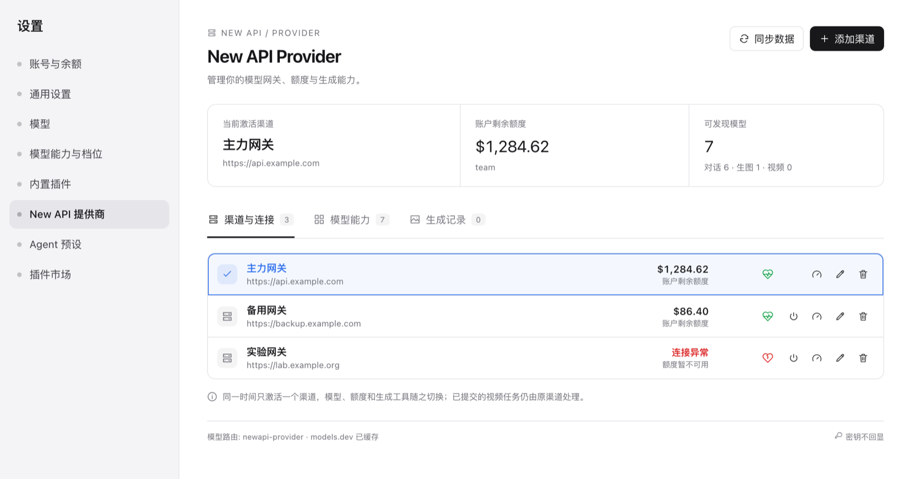
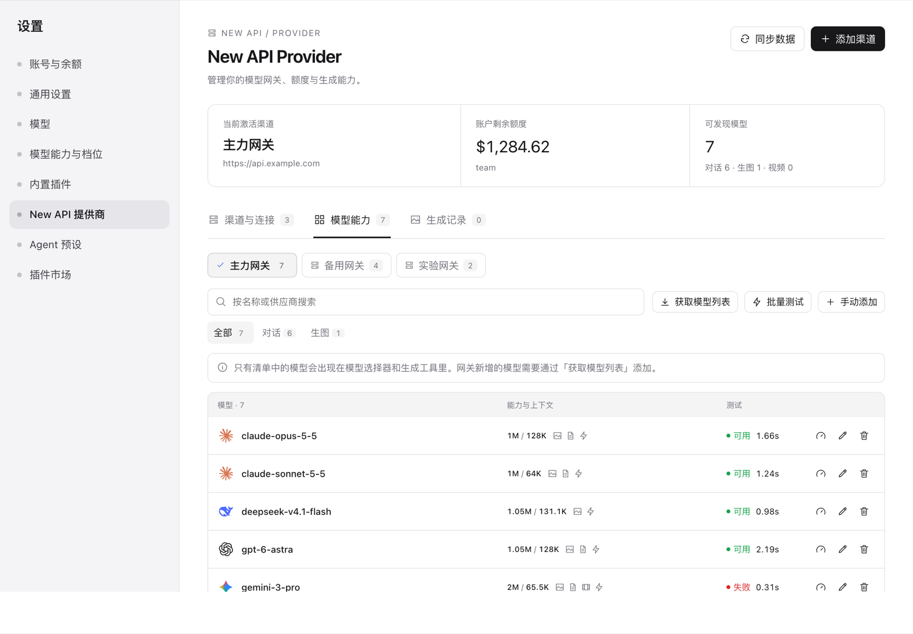
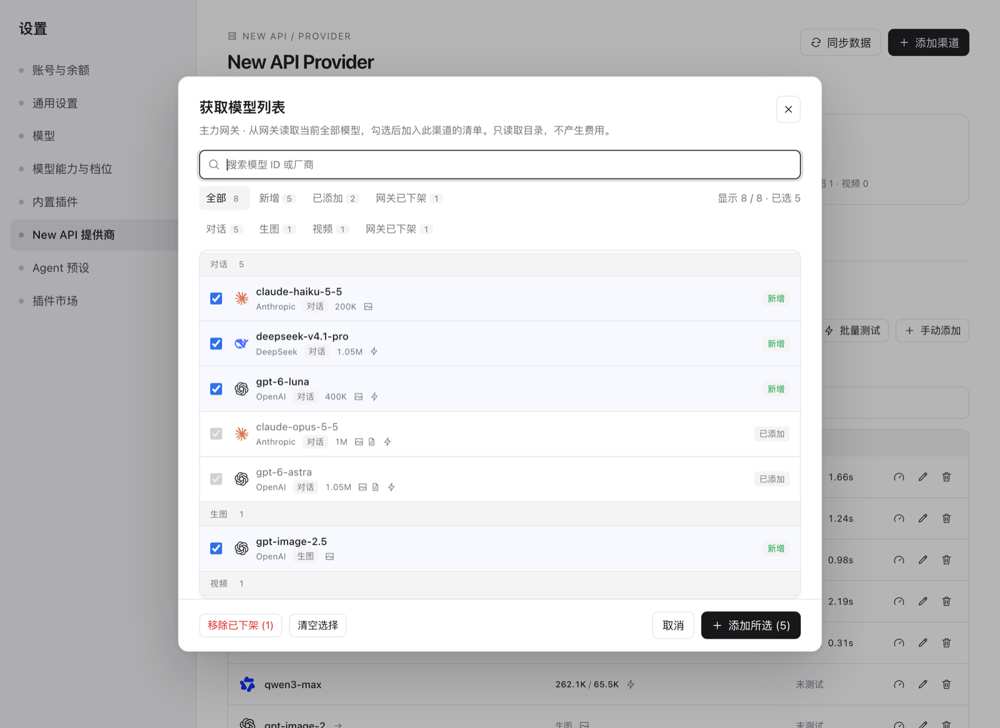
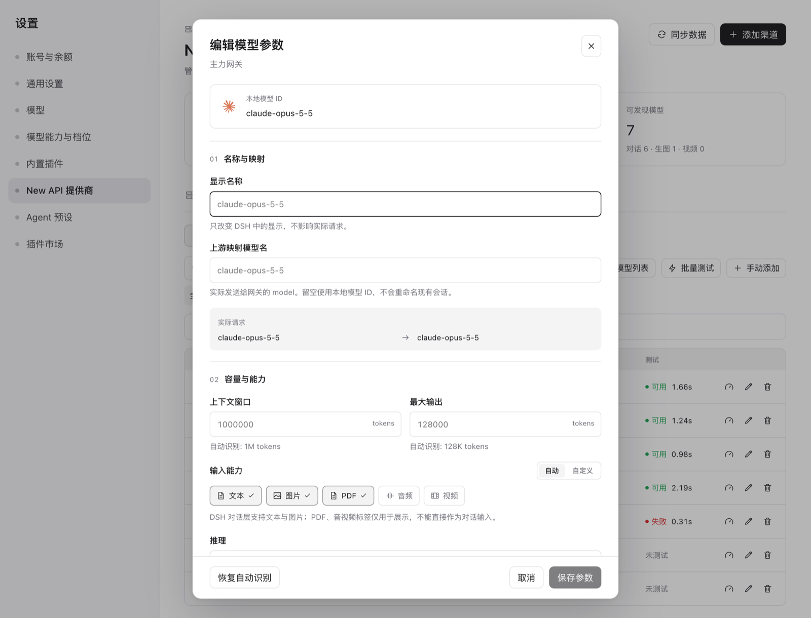
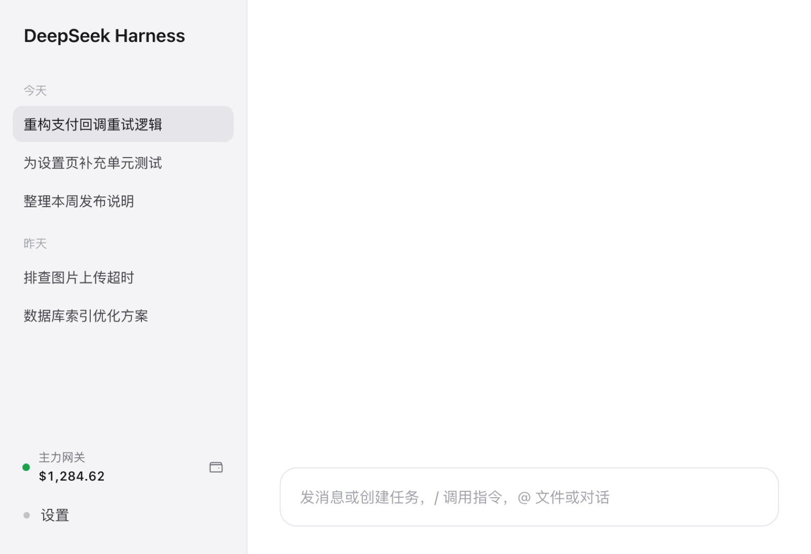

# New API Provider

English · [中文](README.zh.md)

A New API gateway workbench for DeepSeek Harness: several gateways with one active at a time, per-gateway model lists and parameter overrides, quota, and image and experimental video generation.

[](https://www.npmjs.com/package/dsh-newapi-provider)
[](LICENSE)



## Preview

| Model capabilities | Fetch models |
| --- | --- |
|  |  |
| **Model editor** | **Sidebar quota** |
|  |  |

The screenshots render this plugin's real components and stylesheet with sample data; gateway names, URLs and amounts are examples. The UI follows the DSH theme, so colours adapt to your skin and dark mode.

## Install

Requires **DSH 0.2.1-rc.1 or newer** (verified on 0.2.1-rc.2) and Node.js 22.19+.

Install `dsh-newapi-provider` with DSH's plugin manager, then refresh the page and open **Settings → New API Provider**. No separate web server is needed.

1. **Add gateway** — name, New API site URL, calling token.
2. **Fetch models** — read what the gateway lists, select the ones you want.
3. **Activate the gateway** — this plugin's model route now serves those models.

The token is stored in the DSH credential service, never in the gateway configuration, and is never sent back to the browser.

## Features

- Several gateways, exactly one active; each keeps its own URL, credential reference, model list and model overrides.
- Channel-scoped model management: fetch what a gateway lists, choose which models appear in DSH, test one model, remove with undo, add models the gateway does not list.
- Capability data from models.dev (context window, output cap, modalities, reasoning), correctable per model, with an optional per-model upstream name mapping.
- Token quota in the settings summary and at the sidebar foot, plus the account balance when the token is allowed to query it.
- Image generation saved as durable DSH attachments with a generation history; experimental video through the unified `/v1/videos` interface with background polling and restart recovery.

## Gateways and quota

1. **Test connection** reads the model list only and does not make paid model calls; it also shows the gateway version and model counts.
2. **Activate** switches every subsequent call made through this plugin, or tick "activate after saving".
3. Switching never rewrites other adapters or your default provider.
4. Submitted video tasks keep their originating gateway and are never polled on a newly activated one.

Quota details:

- Quota comes from `GET /api/usage/token/` (note the trailing slash).
- Amounts are converted with `/api/status` (`quota_per_unit`, `quota_display_type`, `usd_exchange_rate`), never the top-up price.
- A token that allows user-quota queries also reports the account balance.
- An unlimited token shows used quota instead of a meaningless negative remainder.
- Both numbers are the site's own; a present catalog or balance does not prove an upstream channel can serve a model.

The sidebar shows the active gateway's name and amount, with a health dot; click it to refresh. It collapses to a status dot when the sidebar is a rail.

## Per-gateway model lists

Each gateway keeps an independent list, even when two gateways point at the same site with the same token:

- **Model capabilities tab** has a gateway picker; the active gateway is marked and its list edits apply to that gateway only.
- **Fetch models** reads the gateway catalog with a search box plus status (new / added / removed upstream) and kind filters, grouped by kind; filtering only changes what is listed, never the current selection. The list scrolls on its own and the action bar stays in view.
- **Remove** only removes the model from this gateway; custom parameters can be kept and the removal can be undone briefly.
- **Add manually** is for models the gateway can serve but does not list.
- Gateways created in current versions start with an empty list; channels saved before the feature existed stay in automatic mode (all gateway models) until their first edit, which materialises the list from what the gateway currently lists.

## Testing models

- **Chat models**: one minimal streaming request. The result remembers success, total latency, first packet time and a redacted error. A stream that only sends `[DONE]` counts as a failure, because it carries no protocol response.
- **Image/video models**: a real generation, so each test asks for confirmation first. Image tests show a preview when the URL is safe to embed; a signed URL is recorded as generated without exposing it.
- **Batch test** covers the chat models currently filtered, three at a time. Stopping prevents queued requests; requests already sent still finish and may be billed.
- Tests are billed requests: chat tests send a tiny completion, image/video tests generate.

## Model names and mapping

- **Local model id**: the stable id used by sessions and the model list; never changed by the editor.
- **Display name** (`name`): label only.
- **Upstream model name** (`upstreamModel`): the `model` actually sent. Empty means the local id. Mapping is one hop and applies to chat, image generation, image edits, video and model tests.
- The editor previews the mapping, resolves automatic protocol/capabilities/pricing from the mapping target, and lets input modalities and reasoning follow the catalog or be pinned. Reset clears every override including the mapping.

Capability data is a hint, not proof: a relay may list a model and still fail to serve it.

## Thinking levels

Vendors do not agree on reasoning levels, so each model resolves its own set instead of every reasoning model showing the same five:

| Vendor / model | Levels offered | Notes |
| --- | --- | --- |
| Claude adaptive thinking (Opus 5 / Sonnet 5 / Fable) | low / medium / high / xhigh / max | no `minimal`, no `off` |
| Older Claude (budget based) | off / minimal / low / medium / high | mapped to token budgets |
| GPT-5.1+ / GPT-6 | off / low / medium / high / xhigh / max | `off` is sent as `none`, no `minimal` |
| GPT-5.0 / o-series | minimal / low / medium / high | GPT-5.0 cannot be turned off; o-series stops at high |
| gpt-5-pro | high only | the vendor accepts nothing else |
| Gemini 3 / 4 | minimal / low / medium / high | `thinking_level` has no off; no xhigh/max |
| Gemini 2.5 | off / minimal / low / medium / high | budget based; Pro cannot really be switched off |
| DeepSeek V4 | off / low / high / max | the vendor folds the in-between levels |
| GLM-5.3 | low / high / max | sending `disabled` errors, so no off |
| GLM-5.2 | all seven | most levels are folded upstream |
| Kimi K3 | low / high / max | no medium, cannot be switched off |
| Qwen3 / unknown | off / minimal / low / medium / high | pi-ai's own default when a model has no levels |

Resolution order: **your override → pi-ai's shipped model data (same model, same behaviour as the built-in provider) → vendor-family default**.

**Model capabilities → Edit model → Thinking levels** opens on a table pre-filled from the model data (turn the switch off to see the detected set read-only). The left column is the level shown in the chat selector — the built-ins (off/minimal/low/medium/high/xhigh/max) or a name you type yourself (1–24 lowercase letters, digits, `-`, `_`); a custom level must carry a value and then appears in the chat selector like any other. The right column is what that level sends upstream; an empty value sends nothing. The mapping is stored per model per gateway and affects only this plugin.

> Limitation: relays rename models (`claude-opus-5-5`), so a family guess fills the gap when the exact id is unknown. Use a custom override if the upstream disagrees. A level only changes the request; whether the upstream honours that depth is up to it.

## Models and modalities

models.dev data is cached. Exact matches win; when nothing matches, defaults apply. Base-model matches, defaults and manual overrides are all marked in the UI. Never treat a guessed capability as something the gateway has proven.

The DSH chat interface currently accepts text and image input only. PDF, audio and video tags are catalog metadata and cannot be sent to a DSH chat. Image and video models serve the generation tools and do not appear as chat models.

## Tools

| Tool | Purpose |
| --- | --- |
| `newapi_balance` | Quota of the active gateway's token (and account, when allowed). Free. |
| `newapi_models` | Models of a gateway (`channelId` optional, defaults to active) with kind, limits, modalities, pricing, mapping. Free. |
| `newapi_channels` | `list`, `test`, `save`, `activate`, `delete`, `model_override`, `models_discover`, `models_set`, `model_test`. Writes need a revision. |
| `newapi_image_generate` | Text-to-image, or image editing when `inputImages` is given. Saves attachments. |
| `newapi_video_generate` | Submits a video task and returns its id. Billed per task. |
| `newapi_video_status` | Lists or checks video tasks and returns the saved file. |

Settings-page actions and these tools share one service, so nothing can drift between the UI and the agent.

**Image and video generation cost money.** A submission whose outcome is unknown is never resent automatically; check the gateway's task log first. Stopping a local watch does not cancel or refund the upstream task.

## Paid results

- A video submission that loses the connection or returns an unreadable body after HTTP 200 is reported as **submission unknown, possibly billed**, and is never resent automatically.
- A video that finished upstream but failed to download stays **generated, retrying download**. Only GET requests are retried, against refreshed URLs; when the recovery deadline passes it becomes **generated, download unsuccessful**. Do not regenerate.
- Concurrent status checks of one task share a single flow, and unloading the plugin aborts in-flight requests so a stale instance cannot overwrite the new cache.
- Failed paid requests are never retried automatically.

## Verification status

- Real chat, model discovery, quota, per-gateway lists and gateway editing have been exercised against a local New API instance (v1.0.0-rc.45).
- A real image request was rejected with HTTP 503 (no available upstream channel). Successful paid image generation is therefore **not yet verified**; the attachment pipeline is covered by offline tests.
- Video is **experimental**: no real video channel was available. Submission, polling, download recovery, restart recovery and duplicate-submission prevention are covered offline only.
- Only one New API deployment has been tested. Other versions and relays may differ in endpoint details.

## Migrating from the former name (v0.7.0)

The plugin was called `dsh-newapi-studio`. The rename covers the package, the loader row and provider route (`newapi-provider`), the HTTP prefix (`/newapi-provider/api/`) and the data directory (`plugin-data/dsh-newapi-provider`).

To migrate an existing installation, back up the profile patch and plugin data, then keep each channel's id, credential reference, model list and overrides while moving the data directory to the new name. Current releases do not read the old directory automatically. Keep existing credential references even if they contain `STUDIO`: they still hold the working tokens; new references use the `NEWAPI_PROVIDER_` prefix.

Sessions pinned to the old `newapi-studio` route must pick models again under the new route. Other adapters are unaffected. Tool names (`newapi_channels`, `newapi_models`, …) did not change.

## Development

```sh
npm test
node --check index.js
node --check client.js
npm pack --dry-run --ignore-scripts
```

To work on a checkout instead of the published package, install the project directory with DSH's plugin manager.

DSH runtime imports are optional peerDependencies supplied by the host, so no DSH package is installed or copied here. Tests use local fake gateways and never read personal credentials. This repository replaces, rather than depends on, `dsh-gateway-provider`; two adapters cannot own the same provider route.

Release steps are in [PUBLISHING.md](PUBLISHING.md).

MIT License. Uses public DSH exports and pi-ai protocol implementations; no third-party plugin source is vendored.

Vendor marks in the model list come from [LobeHub Icons](https://github.com/lobehub/lobe-icons) (`@lobehub/icons-static-svg` 1.97.0, MIT License), inlined as SVG so the page makes no remote image requests. Brand marks belong to their respective owners and only identify a model's vendor.
